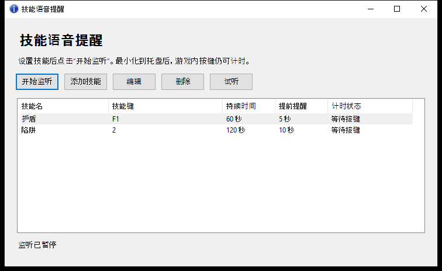
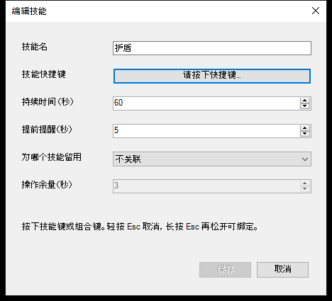
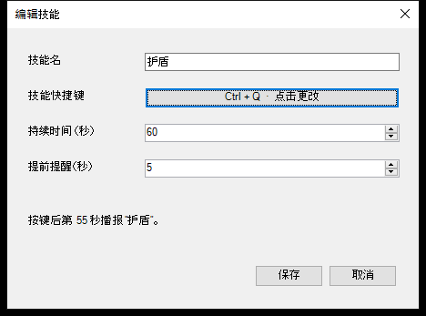

# 技能语音提醒

在 Windows 上玩游戏时，按下技能快捷键，工具就会在后台计时，到点用中文念出技能名。例如「护盾」持续 60 秒，设为提前 5 秒提醒，施放后第 55 秒就会听到“护盾”。中途补放会从最近一次按键重新计时。

[下载 Windows 便携版](https://github.com/ComingPeopleHW/skill-voice-timer/releases/latest/download/SkillVoiceTimer-Windows.zip)。解压后双击 `SkillVoiceTimer.exe`。适用于装有 .NET Framework 4.8 或更高版本的 Windows 10 / 11。

## 把「护盾」绑到 Ctrl + Q

**1. 打开技能列表。** 每行显示一个技能的快捷键、持续时间、提前量和计时状态。在「监听」列勾选这次要用的技能。双击「护盾」可以修改默认的 `F1` 绑定，也可以点「添加技能」配置其他技能。



**2. 直接按下游戏里的快捷键。** 在编辑窗口点击「技能快捷键」右侧的按钮。出现「请按下快捷键…」后，按住 `Ctrl` 再按 `Q`。也可以直接按单键，例如 `Home` 或 `End`。轻按 `Esc` 可取消这次录入，按住至少 0.6 秒再松开可绑定 `Esc`。



**3. 确认提醒时间并保存。** 按钮会显示 `Ctrl + Q`。将持续时间填为 60 秒、提前提醒填为 5 秒，窗口会提示「按键后第 55 秒播报“护盾”」。希望技能结束时再提醒，可以把提前量设为 0。



点「保存」回到主窗口，选中「护盾」点「试听」，勾选要用的技能，再点「开始监听」并切回游戏。窗口最小化到托盘后仍会监听，双击托盘图标可返回。暂停监听会清空倒计时，关闭主窗口会退出。

如果试听时找不到可用语音，请在 Windows 语言或语音设置中为中文安装“文本到语音”功能，再重开工具试听。程序优先使用本机的简体中文桌面语音。

## 切换预设与调节音量

用「新建预设」为刷怪、Boss 或不同角色建立独立配置。默认复制当前技能和勾选状态，也可取消复制，从空列表开始。同一个快捷键在不同预设中可以绑定不同技能。下拉选择预设后，旧预设的计时和播报会清空，接下来的按键使用新预设。下次启动会恢复上次选择。

「语音音量」可输入 0 到 100，按 Enter 或移开焦点后点「试听」。所有预设的试听和提醒共用这个数值，0 为静音。旧版技能自动归入「默认」预设，原有的勾选状态保留。

## 计时规则

- 只有勾选的技能会触发计时。监听中可以随时调整勾选，取消勾选会撤销该技能尚未播报的提醒，再次勾选后从下一次按键重新计时。全部取消勾选时会等待，重新勾选后继续监听。
- 勾选状态会自动保存。新增技能默认勾选。
- 每次按下技能键，按「持续时间 − 提前量」安排一次提醒。长按只计一次，松开重按会替换该技能原有的提醒。
- 各个技能独立计时。语音逐条播放，同时到期时先播先按的技能。等待播报时补放，也会取消该技能的旧提醒。
- 监听期间，在其他应用里按绑定键也会开始计时。在技能编辑窗口内输入时会暂时忽略新的施放。程序按实际按键推定施放时间，游戏是否施放成功由玩家确认。
- 修改或删除一个技能会清除它自己的倒计时。设置保存在 `%LOCALAPPDATA%\SkillVoiceTimer\presets.xml`，下次启动时恢复。启动时默认暂停监听。
- 可以使用 Ctrl、Alt、Shift、Win 搭配主键，如 Ctrl + Home、Shift + End。单独轻按修饰键也可绑定，例如只按一下 Shift，在松开时开始计时。组成组合键时只触发对应组合。左右修饰键等效，原有绑定可以继续使用。
- 可以录入 Windows 作为键盘事件交付的主键，包括 Home、End、Page Up、Page Down、Insert、Delete、Enter、小键盘运算键和 F13–F24。部分 Fn 键、系统快捷键或特殊媒体键由固件或 Windows 处理，实际取决于键盘和系统。
- 后台使用 Windows Raw Input 接收按键，游戏继续正常收键。语音使用本机 Windows 语音合成。

## 从源码构建

在装有 .NET SDK 和 .NET Framework 4.8 Targeting Pack 的 Windows 电脑上运行：

```powershell
dotnet build tests/SkillVoiceTimer.Checks.csproj -c Release
.\tests\bin\Release\net48\SkillVoiceTimer.Checks.exe
.\bin\Release\net48\SkillVoiceTimer.exe
```

GitHub Actions 在 Windows 上构建便携包，检查重新计时、长按去重、多技能播报顺序、配置持久化、窗口创建和后台键盘注册。
